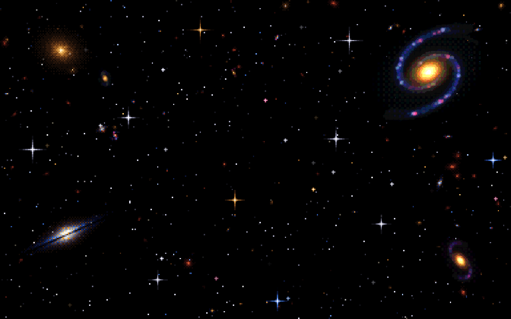

# Deep space

A deep-black theme for Claude Code, after the Hubble Deep Field. It runs as a mod.



- **Desktop and mobile apps:** a pixel-art deep field fills the space behind the conversation. Spiral galaxies turn in their tilted disks, a step at a time (one turn every 2 to 4 minutes), about a hundred stars fade up and down in palette steps, and the long spikes on the bright stars come and go. Every so often a shooting star streaks across a corner of the sky, and a satellite drifts across the top every five minutes. With reduced motion turned on in your system settings, it stays still.
- **Desktop app colors:** near-black surfaces with a faint violet cast. Accents are taken from Hubble images: blue spiral arms, gold galaxy cores, pink star-forming knots.
- **Terminal:** a matching color theme, **Deep space**, that you pick in `/theme`. The terminal app draws its own background, so set it to pure black for the deep blacks.

## Install

At the prompt of a Claude Code terminal session:

```
/plugin install deep-space --marketplace cstillick/claude-deep-space
```

Answer `y` to add the marketplace, then press Enter to install at the user scope, so every session gets it. A user-scope install also loads in the desktop app's local sessions.

From a shell:

```bash
claude plugin install deep-space --marketplace cstillick/claude-deep-space
```

In the desktop app, where `/plugin` does not run: click **+** next to the prompt box, then **Plugins**, then **Add marketplace** with `cstillick/claude-deep-space`, then **Add plugin**.

The background and colors appear when a session starts, so start a new session after installing. To use the terminal colors, run `/theme` and pick **Deep space**.

## Turning it on and off

| Type | What it does |
| --- | --- |
| `/deep-space` | Switches the theme off if it's showing, on if it isn't |
| `/deep-space off` | Goes back to the app's own look, in this session and new ones |
| `/deep-space on` | Brings the deep field and colors back, and paints them again if another theme replaced them |

The choice is kept between sessions. It runs right away, even while Claude is mid-reply.

## Where it shows

| Surface | What you get |
| --- | --- |
| Desktop app | Animated background, plus colors in the Code tab |
| Mobile app | Animated background |
| Terminal | Color theme in `/theme` |
| claude.ai in a browser | Nothing (plugins don't draw there) |

It needs a recent Claude Code: v2.1.324 or later for the desktop colors.

## Changing the scene

`hooks/scene.js` is generated. Edit `gen-scene.mjs` (galaxy placement, colors, turn speeds, twinkle speed, shooting stars, the beat) and rebuild it with Node:

```bash
node gen-scene.mjs hooks/scene.js preview.svg
```

Open `preview.svg` in a browser to watch the result.

The desktop app draws a scene still, with no error, if its SVG uses `shape-rendering`, an `@media` rule other than `prefers-reduced-motion`, or the filter steps `feTile` or `feImage`. The scene avoids all of them, and a test fails if one comes back. That is also why the spiral galaxies are drawn as frames rather than snapped to pixels by a filter.

## Files

- `hooks/register.tsx`: sets the theme when a session starts, serves `/deep-space`, and draws the background
- `tests/deep-space.test.tsx`: run with `claude plugin test .`
- `hooks/scene.js`: the animated SVG scene
- `hooks/make-colors.js`: the design system's palette builder, used to make the app colors
- `themes/deep-space.json`: the terminal color theme
- `gen-scene.mjs`: builds `hooks/scene.js`
